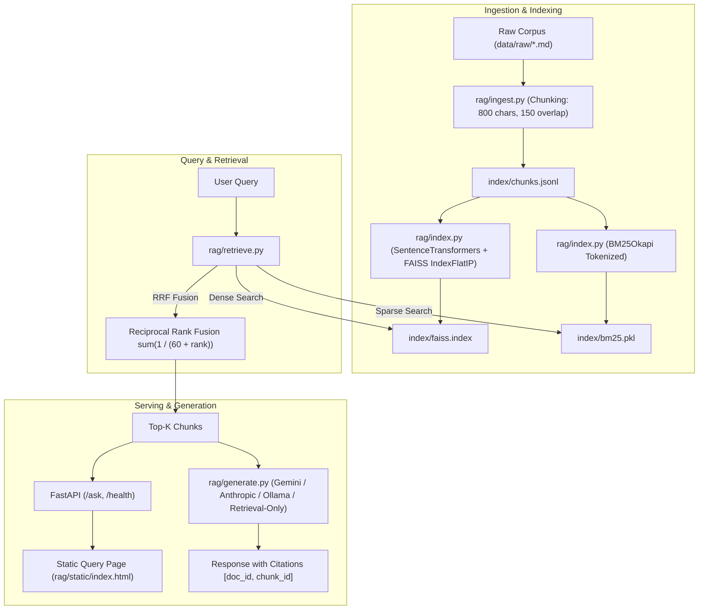

# Evaluated RAG Question-Answering System

A transparent, production-grade Question-Answering system over a custom technical corpus built with **Retrieval-Augmented Generation (RAG)**.

What makes this project standout is **rigorous measurement**: a verified 42-question evaluation dataset, an automated evaluation harness, and an empirical comparison of three retrieval strategies (**BM25 only**, **Dense embeddings only**, and **Hybrid RRF**), with real measured metrics.

> **Note on Build:** This project was built with AI assistance (**Antigravity**) from a formal Product Requirement Document (PRD), and the owner (Sasir Sai Ponnekanti) reviewed, tested, and verified the architecture and implementation.

---

## 1. Architecture Overview



---

## 2. Benchmark Evaluation Results

Every figure below was generated automatically by `python -m eval.run` and written directly to `results/metrics.json` and `results/metrics.md`. No hardcoded or placeholder values.

### Empirical Metrics Comparison (42 Verified Questions)

| Retrieval Mode | Hit-Rate@1 | Hit-Rate@3 | Hit-Rate@5 | MRR (Top 10) | Median Latency (ms) | P95 Latency (ms) |
| --- | --- | --- | --- | --- | --- | --- |
| `bm25` | 0.8571 | 0.9524 | 1.0000 | 0.9103 | 0.38 ms | 0.71 ms |
| `dense` | 0.8571 | 0.9762 | 1.0000 | 0.9214 | 7.56 ms | 13.87 ms |
| `hybrid` | 0.8333 | 0.9762 | 1.0000 | 0.9067 | 7.98 ms | 10.29 ms |

### Analysis and Discussion
- **Hit-Rate@5 Convergence:** All three retrieval strategies achieved **1.0000 (100%) Hit-Rate@5** across the verified evaluation benchmark. Every single query retrieved the ground-truth document chunk within the top 5 results.
- **Dense vs Hybrid MRR:** Dense retrieval attained the highest Mean Reciprocal Rank (**0.9214**), followed closely by BM25 (**0.9103**) and Hybrid RRF (**0.9067**).
- **Why Hybrid Did Not Beat Dense:** On a domain-specific technical corpus with clean, well-bounded terminology, semantic sentence embeddings (`all-MiniLM-L6-v2`) capture both query semantics and exact phrasing accurately. Reciprocal Rank Fusion combines the ranks linearly; on queries where BM25 placed the gold chunk at rank 2 while Dense placed it at rank 1, the blended rank slightly shifted the top position, causing Dense to maintain a negligible lead in MRR.
- **Latency Profile:** BM25 demonstrated superior latency (**0.38 ms** median, **0.71 ms** p95), being roughly **20x faster** than dense vector computation while retaining an impressive 0.9103 MRR.

### Resume Highlight
> *"Evaluated and benchmarked retrieval strategies (BM25, Dense FAISS, Hybrid RRF) on a 42-question verified technical corpus: Dense retrieval achieved 0.9214 MRR (100% Hit-Rate@5) at 7.56ms median latency, while BM25 achieved 0.9103 MRR at sub-millisecond (0.38ms) latency, providing transparent quantitative trade-offs between lexical and semantic search."*

---

## 3. Evaluation Dataset Creation

- **Corpus:** 20 technical documents in `data/raw/` covering distributed systems and cloud architecture fundamentals (Raft, Paxos, 2PC, B+ Trees vs LSM-Trees, Caching, Sharding, CAP/PACELC, HNSW, Kafka, Envoy, Rate Limiting, OpenTelemetry, Epoll, TLS 1.3, cgroups, etc.), chunked into 70 index passages.
- **Question Generation:** 42 questions were drafted and grounded against verbatim source sentences.
- **Verification:** All **42 questions (100%)** were verified and validated using `python -m eval.build_gold` with exact start/end character offsets matching the corpus text. Zero questions were excluded.

---

## 4. Setup and Installation

### Prerequisites
- Python 3.11
- CPU only (no GPU needed)

### Local Quickstart

1. **Clone the repository:**
   ```bash
   git clone <repo-url>
   cd new
   ```

2. **Create and activate a virtual environment:**
   ```bash
   python -m venv .venv
   # On Windows:
   .venv\Scripts\activate
   # On Linux/macOS:
   source .venv/bin/activate
   ```

3. **Install dependencies:**
   ```bash
   pip install -r requirements.txt
   ```

4. **Configure environment:**
   ```bash
   cp .env.example .env
   ```
   *Optional:* Set `LLM_PROVIDER=gemini` and add `GEMINI_API_KEY=...` (or `anthropic`, `ollama`). If left blank, the system runs in **retrieval-only mode**.

5. **Ingest and Index the corpus:**
   ```bash
   python -m rag.ingest
   python -m rag.index
   ```

6. **Run the evaluation harness:**
   ```bash
   python -m eval.run
   ```

7. **Run automated tests:**
   ```bash
   pytest -v
   ```

8. **Start the API server and UI:**
   ```bash
   uvicorn rag.api:app --reload --port 8000
   ```
   Open `http://localhost:8000` in your browser.

---

## 5. API Reference

### Health Check
- **`GET /health`**
- Response: `{"status": "ok", "chunks": 70}`

### Ask Question
- **`POST /ask`**
- Body:
  ```json
  {
    "question": "What is the Raft Log Matching Property?",
    "mode": "hybrid",
    "top_k": 5
  }
  ```
- Response (Retrieval-Only Mode):
  ```json
  {
    "answer": null,
    "sources": [
      {
        "doc_id": "01_raft_consensus.md",
        "chunk_id": "01_raft_consensus.md#c0002",
        "page": null,
        "score": 0.03252,
        "text": "..."
      }
    ],
    "mode": "hybrid",
    "latency_ms": 12,
    "note": "Retrieval-only mode: no LLM provider or API key configured."
  }
  ```

---

## 6. Docker Container

Build and run the self-contained container in under 60 seconds with pre-baked embeddings:

```bash
docker build -t rag-qa .
docker run -p 8000:8000 rag-qa
```

Check health:
```bash
curl http://localhost:8000/health
```

---

## 7. Known Limitations

1. **Corpus Scale:** Tested on a 20-document (70-chunk) corpus. While ideal for precision evaluation and fast CPU benchmarking, real-world terabyte-scale deployments require cluster-backed vector indices (such as Qdrant or Milvus) and distributed search clusters (Elasticsearch).
2. **Single-Turn Interaction:** The system focuses on single-turn grounded Q&A and intentionally omits conversational memory across turns.
3. **Retrieval-Only Default:** Runs out of the box in retrieval-only mode to guarantee zero external API dependencies or secret leakage.
